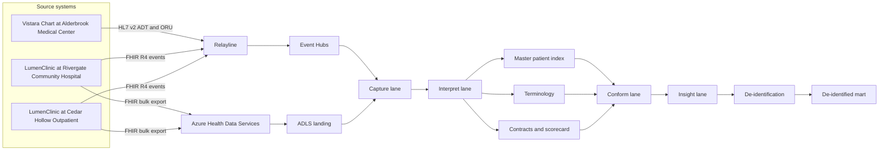
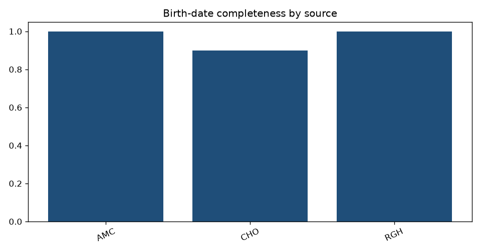
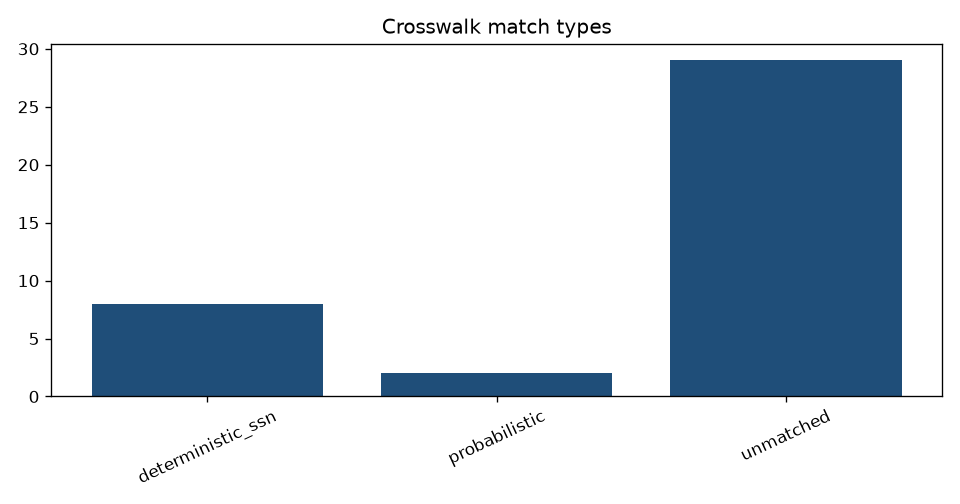
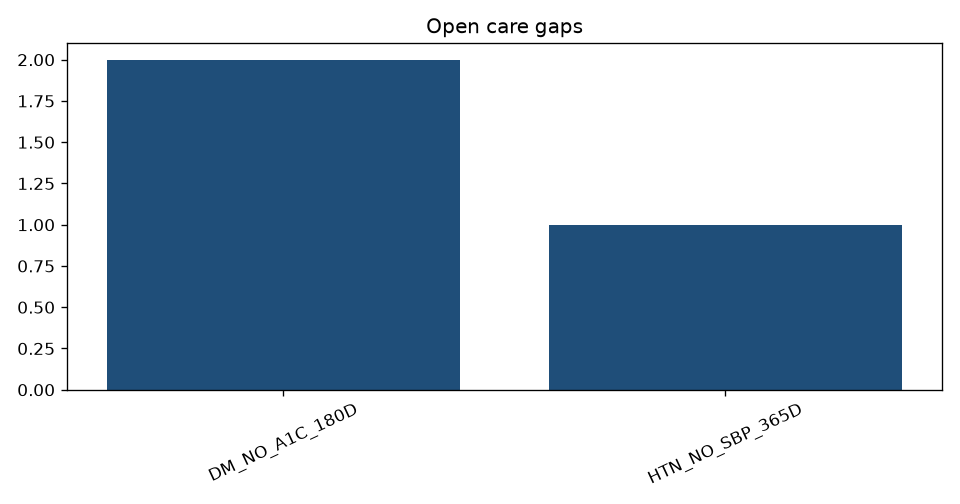

# Northline

Northline is the clinical interoperability platform for **Alderbrook Care Network**, a fictional regional health system. Three facilities register the same people in two electronic health records. Alderbrook Medical Center sends HL7 v2 from Vistara Chart. Rivergate Community Hospital and Cedar Hollow Outpatient send FHIR R4 from LumenClinic. Northline turns that traffic into one enterprise person, a standard clinical record, and a Patient 360.

The as-of date for every measure in this repository is **2026-11-01**. It is fixed so a rerun produces the same cohorts.

## The clinical problem

A patient can leave Cedar Hollow in the morning and be admitted at Alderbrook the same week. The charts do not share a medical record number. Names are nicknames or typos. A lab result can sit on the Relayline interface engine and arrive after a later result. Local lab codes are not LOINC. Analysts still need a defensible answer to five questions:

- Who is the same person across Vistara Chart and LumenClinic?
- Which inpatient stay was followed by another inpatient stay within 30 days, and which short gap was a transfer?
- Which potassium results are persistently abnormal?
- Which people with diabetes have no HbA1c in the last 180 days, and which people with hypertension have no systolic blood pressure in the last year?
- Which source is missing birth dates, addresses, or mappable codes?

The population is synthetic. Identifiers that look like SSNs use the unissued 900 range. No real patient, facility, or practitioner is represented. SNOMED CT, LOINC, ICD-10-CM, and RxNorm identifiers in the crosswalks are public codes used here for education; production use needs the appropriate terminology licenses.

## What Northline decides

Northline is organized as five lanes. The names describe the clinical work, not a storage tier.

| Lane | What it holds | Why it exists |
| --- | --- | --- |
| Capture | The envelope that arrived, exactly once per transport id | Audit of the bus and the bulk export |
| Interpret | HL7 segments and flattened FHIR elements, still in source codes | Parsing is not the same job as mastering identity |
| Conform | Enterprise person, survivorship, LOINC / SNOMED / ICD-10 / RxNorm | One row a measure can trust |
| Insight | Timeline, length of stay, readmission, trends, cohorts, care gaps | Computed on identified data, before de-identification |
| De-identified | Age band, ZIP3, year, flags, tokens | What an analyst is allowed to see |



## Two ways a fact arrives

An ADT or ORU message is an HL7 v2 string. A FHIR resource is JSON, either as a single event or as a line in a bulk-export NDJSON file. Both are wrapped in the same envelope (`contracts/envelope.schema.json`) and land in `capture.events` through a Delta merge on `event_id`.

Structured Streaming reads a directory of those envelopes locally. That directory stands in for Event Hubs. The Kafka options for the Event Hubs endpoint are built in `capture/transports.py` and are not started here. Each micro-batch:

1. Rejects envelopes that fail the contract and appends them to `capture.dead_letter`.
2. Flags an event as late when its event time is older than the watermark from the **previous** batch minus two hours.
3. Merges the row into `capture.events`. A replayed `event_id` updates the same row.
4. Moves the watermark forward only after the batch is classified, so a historical backfill is not marked late just because the file contains older clinical dates.

Late clinical data is kept. A delayed ALT is still an ALT. It is flagged so operations can see interface lag, and it still reaches the lab trend.

Interpretation then rebuilds the clinical tables from capture. The transport id is not the clinical key. An HL7 retransmission with a new transport id and the same MSH-10 collapses to one revision. A FHIR bulk row and a FHIR event with the same resource version collapse the same way. ADT owns the encounter. An ORU may point at a visit number, but it does not create or rewrite the stay, and its PID demographics do not win survivorship.

## Identity and vocabulary

Matching is deterministic first and probabilistic second.

- A synthetic SSN in the 900 range is an automatic link. Any other number is ignored as a match key and recorded as `PER-SSN-NOT-SYNTHETIC`.
- The same normalized given name, family name, birth date, and sex are an automatic link. Nicknames such as Bob map to Robert before that comparison.
- Otherwise a blocked pair is scored with Jaro-Winkler. At or above 0.86 the pair links. From 0.70 up to 0.86 it waits on the review queue. Conflicting synthetic SSNs are never automatic.
- Blocks are Soundex of the family name plus birth year, and Soundex plus ZIP3. The demo compares **8** pairs out of **741** possible pairs.

Survivorship is not "latest row wins" for every attribute. Alderbrook Medical Center outranks Rivergate, which outranks Cedar Hollow, for the legal name. Phone uses the latest authoritative registration. Lab PID copies are not authoritative.

Local codes join to a small crosswalk with a broadcast hash join. Unmapped codes stay on the conformed observation with `map_status = unmapped` and are listed in quarantine. Measures that require LOINC do not see them.

## Trust boundaries

Hard data-quality failures never enter the conformed model: missing name, future or impossible birth date, illegal sex code, a discharge before admit, a missing observation code, or a glucose of 4000. Soft failures, such as a missing address or a year-only birth date, stay on the scorecard and still flow. The rule catalog is `contracts/dq_rules.yml`.

| Zone | Who it is for | What was checked locally |
| --- | --- | --- |
| Interpret snapshot | Interface analysts | May contain a synthetic SSN |
| Conform golden person | Care coordination | `ssn` column removed; `ssn_token` is a salted SHA-256 |
| De-identified encounter fact | Analytics | No name, address, phone, birth date, MRN, or enterprise id |

Unity Catalog masks and the facility row filter are SQL in `sql/unity/masking.sql`. They were not executed. There is no Unity Catalog metastore in this environment.

## Local run

Details and prerequisites are in [docs/setup.md](docs/setup.md).

```bash
python -m pip install -e ".[dev]"
export SPARK_LOCAL_IP=127.0.0.1
export ACN_TOKEN_SALT=local-dev-salt-not-for-production
make test
make pipeline
```

`make pipeline` writes the demo population, the Delta lake under `data/lake`, and the files in `evidence/`. `make smoke` is the smaller population used by CI. The dev salt is published so the synthetic tokens are reproducible. Production reads `ACN_TOKEN_SALT` from Key Vault.

## Evidence from the local demo run

These figures come from `evidence/run_metrics.json`, produced by Spark **3.5.6** on this machine on **2026-11-03T17:44:09Z**. They are local timings, not a Databricks cluster.

| Measure | Value |
| --- | --- |
| Profile | demo |
| Capture events after transport dedupe | 110 |
| Duplicate transport replays collapsed | 1 |
| Late events retained | 1 |
| Dead letters | 4 (3 interpret, 1 capture contract) |
| Source persons | 39 |
| Enterprise persons | 34 |
| Automatic links | 5 |
| Pairs compared / possible | 8 / 741 |
| Review queue | 1 (Helen Cho, score 0.78, birth year off by one) |
| Quarantine rows | 9 |
| Encounters in the fact table | 25 |
| Inpatient encounters | 8 |
| 30-day readmissions | 2 (V-ELENA-2, V-JUNE-2) |
| Transfers under 24 hours | 1 (V-LUIS-RGH) |
| Readmission rate | 0.25 |
| Diabetes / hypertension cohorts | 3 / 2 |
| Care gaps | HbA1c 2, systolic blood pressure 1 |
| Lab trend rows | 9 |
| Timeline rows | 44 |
| Mean scorecard pass rate | AMC 0.9517, CHO 0.9778, RGH 1.0 |
| De-identified identifier columns | none |
| Broadcast join observed | yes |
| OPTIMIZE ZORDER | ran in 1.525 s; file count stayed 3 (17,700 bytes before and after) |

Stage seconds, local: bulk 6.274, stream backfill 5.835, stream delayed 4.797, interpret 1.529, conform 10.974, insight 16.952, total **47.946**.

Elena Voss is one enterprise person. The golden given name is Elena, from Alderbrook, not the clinic typo Elaina. The golden phone is the later clinic number 5035550199. Willa Brooks's street survives HL7 escaping as `12 Pine & Oak St`. The second potassium of 6.1 mmol/L is the persistent abnormal. Quinn Adler's `ZZZ-NOT-A-CODE` is quarantined and is absent from the lab trend. Sofia Alvarez and Sofia Alvares link probabilistically. James Miller born in 1960 and James Miller born in 1990 stay two people.

The smoke profile, which the integration test locks, was also run locally. It keeps the same readmissions, transfer, care gaps, one late event, four dead letters, and five automatic links, on 27 source persons and 22 enterprise persons. Demo adds 12 single-facility filler charts, which is why the demo counts are 39 and 34.







`evidence/dashboard.html` is the same aggregate scorecard rendered from that JSON. It is not a Power BI screenshot. The capture log is two lines in `evidence/pipeline.log`.

Tests on this machine: **24 passed**, coverage **88%** with branch coverage (`pytest --cov=acn_interop` on Spark 3.5.6). Bicep **0.38.33** compiled `infra/bicep/main.bicep` with no errors and no warnings after the authority URL was taken from `environment()`. Nothing in this repository was deployed to Azure.

## Tested here vs Azure-only

| Capability | Local result | Azure-only |
| --- | --- | --- |
| HL7 v2 parser, escapes, repetitions | Unit tests and the demo feed | |
| FHIR R4 flatten, extensions, validation | Unit tests and the demo feed | |
| Structured Streaming, checkpoints, watermark, late flag, merge | File source, two waves, replay does not add rows | Event Hubs Kafka source is coded and not started |
| FHIR `$export` NDJSON landing | Local folder merged on a deterministic id | Azure Health Data Services and ADLS |
| Master patient index and survivorship | Demo and unit tests | GraphFrames-scale connected components |
| Terminology broadcast join and quarantine | Physical plan contained Broadcast | |
| Patient 360 SQL | Executed in the local session | |
| De-identification | Column check on the written table | Unity Catalog masks and row filters |
| OPTIMIZE ZORDER | Timed on the local encounter table | Liquid clustering SQL is not executed |
| Bicep | Compiled | Not deployed |
| Databricks Asset Bundles, Data Factory, Key Vault, Monitor, Power BI | Files only | Not deployed, no service screenshots |

## Challenges worth knowing

The watermark is about arrival delay, not about clinical history. A backfill that spans months is one batch and nothing in it is late. A result that shows up in the next batch, hours behind the watermark, is late and still kept.

Birth-year blocking misses a chart whose birth year was typed wrong. Northline also blocks on Soundex plus ZIP3, which is how Helen Cho reaches the review queue instead of being silently dropped. Father and son James Miller do not share a ZIP3 or a birth year, so the scorer is not asked to separate them. Olivia Grant and Noah Grant share both a year and a ZIP and are scored and rejected.

A glucose of 4000 maps to LOINC and then fails the plausible-range rule. An unmapped local code fails vocabulary handling instead, on purpose. Those are different queues.

## Where to read next

- [docs/setup.md](docs/setup.md) — local prerequisites and commands
- [docs/data-dictionary.md](docs/data-dictionary.md) — tables and classifications
- [docs/azure-deployment.md](docs/azure-deployment.md) — Bicep, bundles, Factory, and what was not run
- [docs/troubleshooting.md](docs/troubleshooting.md) — checkpoints, Java, watermarks, tokens
- [docs/engineering-decisions.md](docs/engineering-decisions.md) — why the lanes, the match rules, and the file layout look like this

## Repository map

```text
src/acn_interop/capture       streaming merge and the Event Hubs Kafka options
src/acn_interop/interpret     HL7 parser and FHIR flattener
src/acn_interop/resolve       normalization, Jaro-Winkler, master patient index
src/acn_interop/vocab         LOINC, SNOMED, ICD-10-CM, RxNorm crosswalks
src/acn_interop/assure        hard and soft rules, scorecard
src/acn_interop/shield        salted tokens and the de-identified projection
src/acn_interop/synthesize    seeded HL7 and FHIR population
src/acn_interop/jobs          local pipeline
sql/insight                   the measure SQL the job executes
sql/unity                     catalog, masks, liquid clustering
infra/bicep                   resource group deployment
databricks.yml                Asset Bundle
orchestration/adf             daily conform pipeline
contracts                     envelope schema and rule catalog
evidence                      output of the demo run on this machine
```
